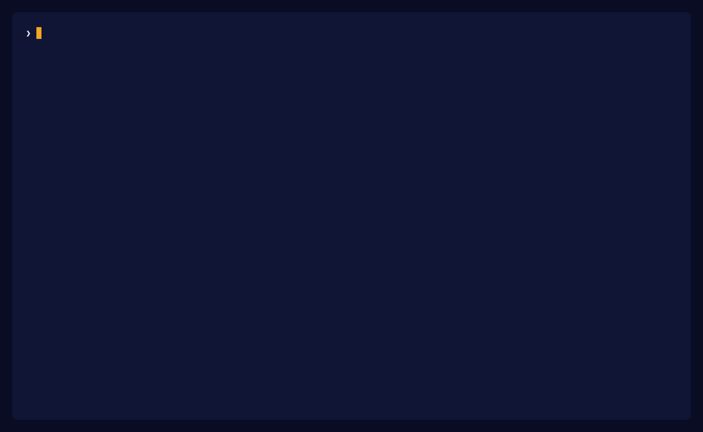

# vaporfit

**Find what Vapor mode breaks in your app, before you add `vapor`.**

<p>
  <a href="https://github.com/hamedniroomand/vaporfit/actions/workflows/ci.yml"></a>
  <a href="https://github.com/hamedniroomand/vaporfit/blob/main/LICENSE"></a>
  <a href="https://vaporfit.kitdev.space/"></a>
</p>

Vue 3.6 brings **Vapor mode**. Add one attribute, `<script setup vapor>`, and the component compiles to code that updates the DOM directly, with no virtual DOM. The goal is faster updates and a smaller bundle.

But not every feature and not every library works in a Vapor component yet. And the worst failures make no sound. The build passes. The console is empty. A button stops opening its dialog, and you find out in production.

vaporfit reads your project and tells you which components are safe to convert, which are not, and why. You get the answer before you change a line.

```sh
npx vaporfit
```

<p align="center">
  
</p>

vaporfit needs Node.js 22.18 or later. Each row of the data names the Vue version of its last test. Read the full docs at <https://vaporfit.kitdev.space>.

## Why vaporfit

- **It finds the failures that give no error.** With `as-child` from Reka UI and Vue 3.6.0-rc.14 or older, a Vapor button gets no attributes and no click listener. Vue prints no warning. vaporfit shows the file, the line, the rule, and the Vue version that fixes the problem.
- **It knows your libraries.** The data has 25 Vue libraries: Reka UI, Element Plus, PrimeVue, Vuetify, Pinia, vue-i18n, VueUse and more. Each row has the verified version, the statement of the maintainers and the known broken features.
- **Each claim has evidence.** A row gets its data from a probe that runs in a real browser, a maintainer text, or an issue link. The repository has 37 probes.
- **It follows the chain.** A cause that is two wrappers away from your page shows at your page, with the path to the library.
- **It plans the migration.** The report ranks the rules that hold back the most components and gives an order: convert the leaves first.
- **It makes the safe changes for you.** `vaporfit fix --write` adds `vapor` to each component that is ready.
- **It does not guess.** When the data does not prove a problem, the verdict is `unknown`, not `ready`.

## Vapor mode in one minute

A normal Vue component renders through the virtual DOM (VDOM). A Vapor component does not. You can use Vapor in two ways, and vaporfit gives a verdict for each:

- **Interop:** your app keeps `createApp()` and installs `vaporInteropPlugin`. Vapor components and VDOM components work together. This is the way to migrate one component at a time.
- **Pure:** your app uses `createVaporApp()` and does not load the VDOM runtime. Each component in the tree must be Vapor.

The [Vue 3.6 release notes](https://github.com/vuejs/core/releases/tag/v3.6.0-rc.14) describe Vapor mode.

## One finding

This finding is from the report for `test/fixtures/shadcn`. That fixture is a small page that passes `as-child` through local `ui/` wrappers into Reka UI. It uses Vue 3.6.0-rc.14.

```text
error silent vf_30bf4dc5fc
as-child does not pass attributes or listeners to the child in a Vapor component. Vue 3.6.0-rc.15 fixes this.
src/pages/Home.vue:8:10
reka-ui/as-child
chain src/pages/Home.vue > src/components/ui/dialog/Dialog.vue > reka-ui
package reka-ui 2.11.0
```

- `silent` is the failure type. The other types are `runtime-error`, `compile`, and `none`.
- `src/pages/Home.vue:8:10` is the file, the line, and the column.
- `reka-ui/as-child` is the rule.
- `chain` shows the path from your component to the cause. Here the cause is two steps away from the page, in a library.
- `package` is the library and its version.
- `Vue 3.6.0-rc.15 fixes this.` names the first Vue version with a fix. A project with that version or a later one gets no finding for this rule.

When the data does not prove a problem, vaporfit says `unknown`:

```text
unknown silent vf_27bd9b5fd7
as-child is confirmed broken on DialogTrigger, TabsTrigger and other trigger components. This component is not tested and the cause is probably the same. Vue 3.6.0-rc.15 fixes this.
src/pages/Home.vue:9:11
reka-ui/as-child-other
chain src/pages/Home.vue > src/components/ui/button/Button.vue > reka-ui
package reka-ui 2.11.0
```

## Two verdicts for each component

From the header of the same report:

```text
components 4
interop 3 ready 1 blocked 0 unknown
pure 0 ready 4 blocked 0 unknown
```

Each component gets an `interop` verdict and a `pure` verdict. Each verdict is `ready`, `blocked`, or `unknown`.

- `interop` is for a Vapor component in a `createApp()` app that installs `vaporInteropPlugin`.
- `pure` is for an app that does not keep the VDOM runtime. A component is pure `ready` only when its interop verdict is `ready` and each resolved child is also Vapor or pure `ready`.

The report also ranks the rules that hold back the most components, lists what keeps the VDOM runtime, and gives an order for the components.

"ready" means that vaporfit found no known problem. It does not test behavior.

## Apply the changes

```sh
npx vaporfit fix
npx vaporfit fix --write
```

`fix` prints the changes and does not write files. `fix --write` writes them only when the app already installs `vaporInteropPlugin`.

The edits add `vapor` to a `ready` component, and remove `v-memo` on a component that receives `vapor` in that same run. A `blocked` component, an `unknown` component, and a component that already has `vapor` stay as they are.

`fix --router` changes `$route` and `$router` to `useRoute()` and `useRouter()`. `fix --i18n` changes `$t`, `$d`, `$n`, `$te`, and `$tm` to `useI18n()`. `--i18n` runs only when the project sets `legacy: false`. The tool does not rewrite a name that clashes.

## Commands

| Command  | Function                                                          |
| -------- | ----------------------------------------------------------------- |
| `check`  | Check the project. This is the default.                           |
| `fix`    | Print the changes. Add `--write` to write the files.              |
| `ui`     | Open the [local report](docs/1.guide/2.ui.md).                    |
| `report` | Write a [static report](docs/1.guide/3.report.md). Use `--out`.   |
| `mcp`    | Serve the report to an [agent](docs/1.guide/5.mcp.md) over stdio. |
| `help`   | Show the help.                                                    |

| Option         | Function                                                    |
| -------------- | ----------------------------------------------------------- |
| `--root <dir>` | Set the project root. The default is the current directory. |
| `--json`       | Print the JSON report.                                      |
| `--strict`     | Exit with 1 for each blocked component.                     |

The [guide](docs/1.guide/1.index.md) lists each option.

## Exit codes

| Code | Cause                                                                                                                |
| ---- | -------------------------------------------------------------------------------------------------------------------- |
| `0`  | No component that has `vapor` is blocked. The plugin finding is not an error.                                        |
| `1`  | A component that has `vapor` is blocked, or the plugin finding is an error, or `--strict` finds a blocked component. |
| `2`  | The input is not valid.                                                                                              |

A blocked component that does not have `vapor` does not fail the run. The report for `test/fixtures/shadcn` has 11 errors and exits with status 0, because the blocked page does not have `vapor` yet. Thus you can add vaporfit to CI before the migration starts. Use `--strict` when a blocked component must fail the run.

## Rules and libraries

- The [rules](docs/3.rules.md) page lists each rule for Vue, with the failure type and links to the Vue source code.
- The [libraries](docs/2.libraries.md) page lists each Vue library in the data, with the verified version, the statement of the maintainers, and the known broken features.

To correct a row, change the library file in `data/libraries` and put the evidence in the same change. The evidence is a probe in `repros/`, a maintainer text with a link, or an issue link. Refer to [CONTRIBUTING.md](CONTRIBUTING.md).

The docs site has the same tables: <https://vaporfit.kitdev.space>.

## Limits

- The tool does not run the application. It does not compare a Vapor result with a VDOM result.
- "ready" means that vaporfit found no known problem. It does not test behavior.
- A Nuxt project is not pure `ready`.
- A library file counts as Vapor when that file contains `defineVaporComponent`.
- The JSON report has `schemaVersion` `0`. A later release can change the fields.

The [limitations page](docs/1.guide/7.limitations.md) explains each limit of 0.1.

## A full report

`repros/vue-object-directive` defines a local object directive. `src/VaporCase.vue` already has `vapor` and it is blocked, so this run exits with status 1.

<details>
<summary>The report for <code>repros/vue-object-directive</code></summary>

```text
vaporfit 0.0.0
vue 3.6.0-rc.15
data 2026-11-12
components 3
interop 1 ready 2 blocked 0 unknown
pure 0 ready 3 blocked 0 unknown
plugin installed
Vue libraries with data: 0
Vue libraries with no data: 1
@vitejs/plugin-vue

error silent vf_ad429c376e
A VDOM component renders nothing in createVaporApp().
src/App.vue:8:19
vapor/vdom-component
chain src/App.vue > src/VdomCase.vue

error silent vf_b31d0ef85a
An object directive is skipped in a Vapor template.
src/App.vue:10:20
vapor/object-directive
chain src/App.vue > src/VaporCase.vue

error silent vf_0945fddc9d
An object directive is skipped in a Vapor template.
src/VaporCase.vue:10:21
vapor/object-directive

error silent vf_36d7288242
An object directive is skipped in a Vapor template.
src/VdomCase.vue:10:21
vapor/object-directive

Holds back the most components
vapor/object-directive 3
vapor/vdom-component 1

Keeps the VDOM runtime
vapor/vdom-component 1

Order
src/VaporCase.vue
src/VdomCase.vue
src/App.vue

Ready
src/App.vue
Vue libraries with data: 0
Vue libraries with no data: 1
@vitejs/plugin-vue

"ready" means that vaporfit found no known problem. It does not test behavior.
```

</details>

## License

[MIT](LICENSE)
